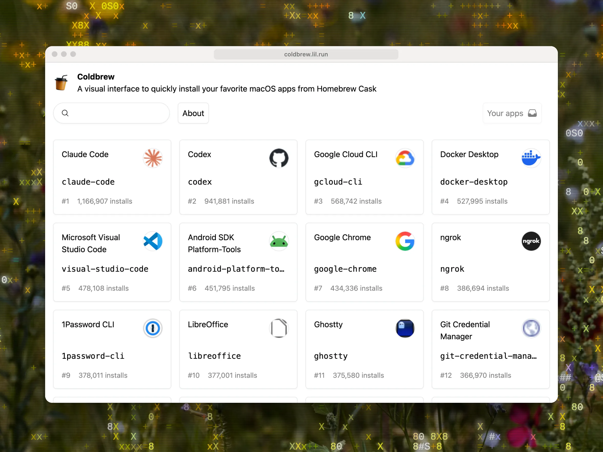

# Coldbrew

- [Coldbrew](#coldbrew)
  - [Introduction](#introduction)
  - [Stack](#stack)
  - [Local development](#local-development)

## Introduction

A visual interface to quickly install your favorite macOS apps from Homebrew Cask



## Stack

- Cloudflare Workers
- Cloudflare D1
- Cloudflare KV
- Next.js
- Tailwind CSS
- Prisma
- TRPC
- TypeScript

## Local development

```bash
pnpm dev
```

Open [http://localhost:3000](http://localhost:3000) with your browser to see the result.
